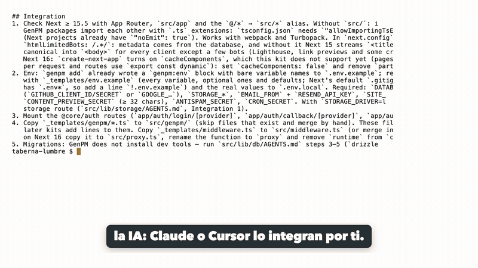
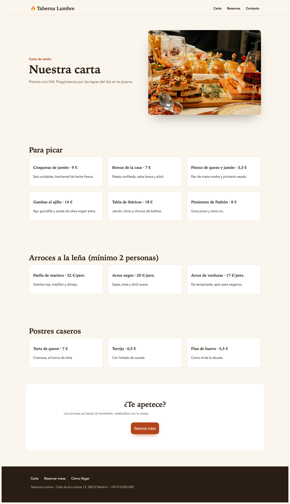
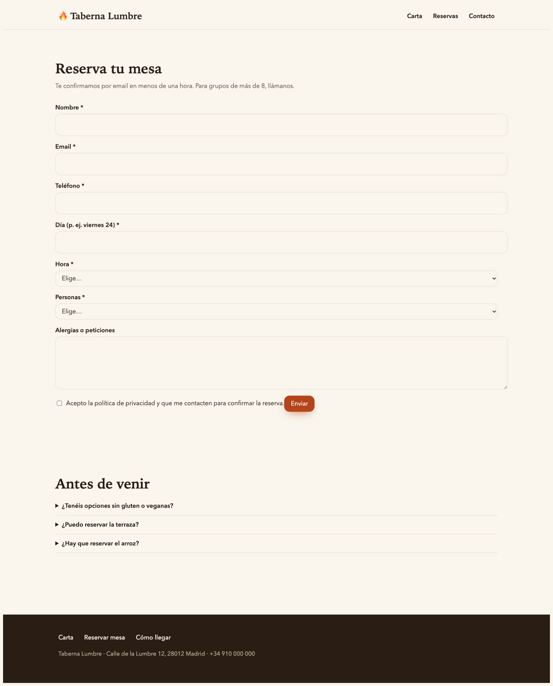
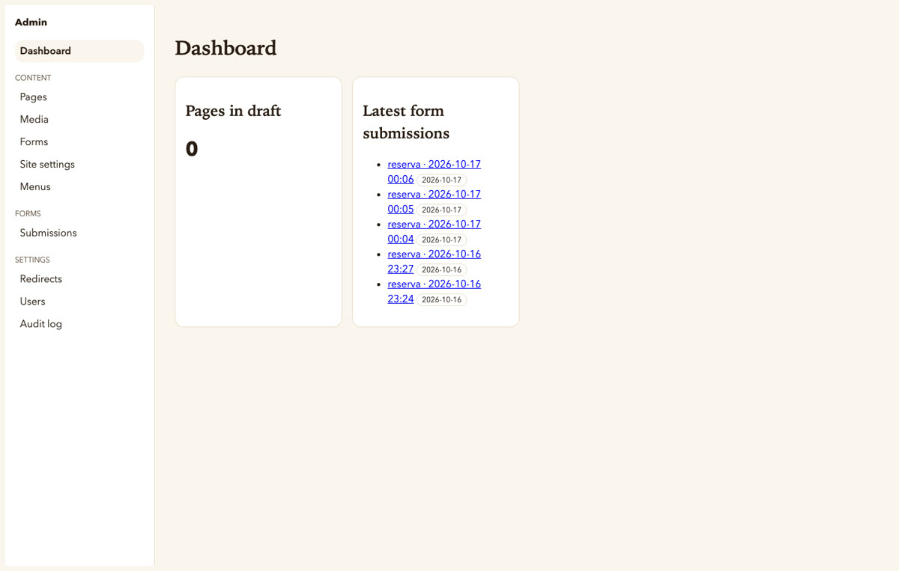

# Taberna Lumbre · demo de GenPM

**La web de un restaurante con carta, reservas online y panel de administración, montada con un comando:**

```bash
genpm add @core/kit-cms
```

[GenPM](https://genpm.net) instaló 19 módulos como **código fuente tuyo** en `src/lib` y `src/app/(cms)`: panel `/admin`,
páginas por bloques, mediateca, formularios con antispam, menús, SEO, buscador, usuarios y roles. Cada módulo trae un
`AGENTS.md` con los pasos de integración, así que tu IA (Claude Code, Cursor, Copilot…) sabe cómo dejarlo funcionando.

> Restaurante ficticio. Fotos de [Unsplash](https://unsplash.com) (licencia Unsplash). [English below](#english).

📘 **Guía paso a paso:** [online](docs/MANUAL.md) · [PDF](docs/manual-restaurante.pdf)



| Carta | Reservas | Panel |
|---|---|---|
|  |  |  |

## Qué incluye

- **Páginas editables por bloques** (hero, servicios, galería, opiniones, cifras, FAQ, llamada a la acción) con borradores, vista previa y publicación programada.
- **Reservas online**: formulario con día, hora, comensales y alergias; cada reserva llega al panel (*Submissions*) y por email.
- **Carta, contacto y menús** editables por el dueño sin tocar código.
- **SEO**: títulos, descripciones, `sitemap.xml`, `robots.txt`, datos estructurados de la FAQ y `llms.txt`.
- **Buscador**, redirecciones, usuarios con roles y registro de auditoría.

## Cómo se hizo (los commits lo cuentan)

1. `npx create-next-app@latest` → proyecto vacío de Next.js 16.
2. `genpm add @core/kit-cms` → 19 módulos inyectados y fijados por SHA en `genpm.lock`.
3. Integración siguiendo `src/app/(cms)/AGENTS.md` (pasos 1–11): `next.config`, variables de entorno, rutas de login, `src/genpm/*`, `src/proxy.ts`, migraciones y layout. Es el trabajo que hace tu agente de IA leyendo esas reglas.
4. Lo propio del restaurante: el formulario `reserva` (`src/genpm/forms.ts`), los textos del formulario en español, el tema cálido (`src/app/theme.css`) y el contenido de ejemplo (`scripts/seed-demo.mts`).

## Pruébalo en local

Necesitas Node 20+, Docker (o cualquier Postgres) y una [OAuth App de GitHub](https://github.com/settings/developers) con callback `http://localhost:3000/auth/callback/github`.

```bash
git clone https://github.com/GenPM-net/demo-restaurante && cd demo-restaurante
npm install
docker run -d --name lumbre-pg -e POSTGRES_PASSWORD=dev -p 5432:5432 postgres:17-alpine
cp .env.example .env.local      # rellena DATABASE_URL, AUTH_SECRET, GITHUB_*, secretos y STORAGE_DRIVER=local
node --env-file=.env.local node_modules/drizzle-kit/bin.cjs migrate --config src/lib/db/drizzle.config.ts
npx tsx --env-file=.env.local scripts/seed-demo.mts     # contenido de Taberna Lumbre
npm run build && npm start
```

Entra en `http://localhost:3000/admin/login` con GitHub y hazte dueño:
`npx tsx --env-file=.env.local "src/app/(cms)/_scripts/create-owner.ts" tu@email.com`.

## Llévalo a tu restaurante

```bash
npx create-next-app@latest mi-restaurante && cd mi-restaurante
curl -fsSL https://genpm.net/install.sh | sh
genpm add @core/kit-cms
```

O pídeselo a tu IA: `genpm mcp setup` y luego *"monta la web de mi restaurante con genpm, con carta y reservas"*.
¿Vendes online? Añade `@core/kit-store`. ¿Un blog? `@core/kit-blog`. Catálogo completo en [genpm.net](https://genpm.net).

---

## English

**A restaurant website with menu, online bookings and an admin panel, built with one command: `genpm add @core/kit-cms`.**
GenPM injected 19 modules as source code you own (admin, block pages, media, forms with spam protection, menus, SEO,
search, users and roles), each with an `AGENTS.md` your AI agent follows to integrate it. The commits show every step:
`create-next-app` → `genpm add` → integration from the rules → the restaurant's own content, theme and booking form.
Run it locally with the commands above. Fictional restaurant; photos from Unsplash.

## License

MIT. The modules in `src/lib` and `src/app/(cms)` are MIT as well (see each `LICENSE`).
