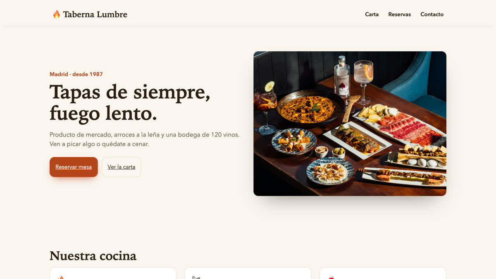

# Guía: la web de tu restaurante con GenPM

**Carta, reservas online y un panel para editarla tú mismo, en una tarde.** Esta guía reproduce paso a paso la demo
*Taberna Lumbre*. No hace falta saber programar mucho: tu asistente de IA (Claude Code, Cursor, Copilot…) puede hacer la
parte técnica siguiendo las instrucciones que trae cada módulo.



## Qué vas a tener al final

- Una web rápida con **portada, carta, reservas y contacto**, en tu dominio.
- Un **panel `/admin`** para cambiar textos, fotos, precios y horarios sin tocar código, con borradores y vista previa.
- **Reservas online**: cada reserva llega al panel y a tu email, con respuesta automática al cliente.
- **SEO** listo: títulos, descripciones, `sitemap.xml`, datos estructurados para Google.
- Todo el código en tu proyecto. Sin cuotas mensuales de plataforma: tú eliges dónde alojarlo.

## Lo que necesitas

| Qué | Para qué | Coste |
|---|---|---|
| Un ordenador con Node.js 20 o superior | Ejecutar el proyecto | Gratis |
| Una base de datos Postgres ([Neon](https://neon.tech), Supabase o Docker en local) | Guardar páginas y reservas | Gratis para empezar |
| Una cuenta de GitHub | Entrar al panel (inicio de sesión) | Gratis |
| Un asistente de IA (opcional) | Que haga la integración por ti | — |

## Paso 1. Crea el proyecto

```bash
npx create-next-app@latest mi-restaurante
cd mi-restaurante
```

Acepta las opciones por defecto (TypeScript, App Router, carpeta `src`).

## Paso 2. Instala GenPM y el kit de web editable

```bash
curl -fsSL https://genpm.net/install.sh | sh      # Windows: irm https://genpm.net/install.ps1 | iex
genpm add @core/kit-cms
```

GenPM te enseña antes **qué va a instalar**: 19 módulos (panel, páginas por bloques, mediateca, formularios con
antispam, menús, SEO, buscador, usuarios y roles). Confirma con **Sí**. El código queda en `src/lib` y `src/app/(cms)`,
fijado a una versión verificada en `genpm.lock`. Nada se ejecuta por su cuenta: GenPM nunca corre scripts de terceros.

## Paso 3. Deja que tu IA lo integre

Cada módulo trae un `AGENTS.md` con sus pasos de integración. Con GenPM conectado a tu asistente
(`genpm mcp setup`, una sola vez), pídele:

> *"Integra @core/kit-cms siguiendo src/app/(cms)/AGENTS.md. Es la web de un restaurante en español."*

Si prefieres hacerlo a mano, el `AGENTS.md` lista 11 pasos; los más importantes son:

1. En `next.config.ts`: `cacheComponents: false` y `htmlLimitedBots: /.*/`. En `tsconfig.json`: `"allowImportingTsExtensions": true`.
2. Copia `src/app/(cms)/_templates/env.example` a `.env.example` y crea `.env.local` con tus valores.
3. Crea las rutas de inicio de sesión (`src/app/auth/...`) y copia `_templates/genpm/*.ts` a `src/genpm/`.
4. Copia `_templates/layout.tsx` a `src/app/layout.tsx` y apunta la portada a la del CMS.
5. Borra los adaptadores de Hono que no usas: `rm src/lib/*/adapters/hono.ts`.

El repositorio de la demo tiene un commit con exactamente estos cambios: *"Integración según AGENTS.md"*.

## Paso 4. Base de datos y variables

En `.env.local` necesitas como mínimo:

```bash
DATABASE_URL=postgres://...            # tu Postgres
AUTH_SECRET=...                        # 32+ caracteres: openssl rand -base64 32
GITHUB_CLIENT_ID=... / GITHUB_CLIENT_SECRET=...
SITE_URL=http://localhost:3000
CONTENT_DEFAULT_LOCALE=es
CONTENT_PREVIEW_SECRET=... ANTISPAM_SECRET=... CRON_SECRET=...
STORAGE_DRIVER=local  STORAGE_SECRET=...  STORAGE_PUBLIC_URL=http://localhost:3000
EMAIL_FROM="Mi Restaurante <reservas@midominio.com>"
```

Crea las tablas:

```bash
npm i -D drizzle-kit tsx
npx drizzle-kit generate --config src/lib/db/drizzle.config.ts
node --env-file=.env.local node_modules/drizzle-kit/bin.cjs migrate --config src/lib/db/drizzle.config.ts
```

## Paso 5. Entra al panel

1. Crea una *OAuth App* en [github.com/settings/developers](https://github.com/settings/developers) con la URL de
   retorno `http://localhost:3000/auth/callback/github` y pon su ID y secreto en `.env.local`.
2. Arranca: `npm run dev` y entra en `http://localhost:3000/admin/login`.
3. Hazte dueño: `npx tsx --env-file=.env.local "src/app/(cms)/_scripts/create-owner.ts" tu@email.com`.


## Paso 6. Crea tus páginas

En **Admin → Pages** crea `home`, `carta`, `reservas` y `contacto`. Cada página se monta con **bloques**: portada con
foto (*Hero*), servicios (*Features*), galería, opiniones (*Testimonials*), cifras (*Stats*), preguntas (*FAQ*) y
llamada a la acción. Sube las fotos en **Media** con su texto alternativo. En **Menus** define el menú de cabecera y de
pie, y en **Site settings** el nombre, dirección y teléfono.

Consejo: para la carta usa un bloque *Features* por sección ("Para picar", "Arroces", "Postres") con un elemento por
plato: *"Croquetas de jamón · 9 €"* y la descripción debajo.


## Paso 7. Formulario de reservas

Los formularios se definen en `src/genpm/forms.ts`. El de la demo pide nombre, email, teléfono, día, hora, comensales y
alergias, con consentimiento RGPD y respuesta automática:

```ts
defineForm({
  key: 'reserva',
  label: 'Reservas',
  schema: z.object({ nombre: z.string().min(1), email: z.email(), telefono: z.string().min(6),
    fecha: z.string().min(4), hora: z.enum(horas), personas: z.enum(personas), notas: z.string().optional() }),
  fields: [/* etiquetas en español, ver el repo */],
  emailField: 'email',
  autoReply: { subject: 'Hemos recibido tu reserva', text: 'Te confirmamos la mesa en menos de una hora.' },
  consent: { required: true, version: '2026-10', text: 'Acepto la política de privacidad…' },
});
```

Añade un bloque **Form** con `formKey: reserva` a la página `reservas`. Las reservas aparecen en **Admin → Submissions**
y llegan al email de `FORMS_NOTIFY_TO`.


## Paso 8. Dale tu estilo

El diseño sale de unas pocas variables de color y tipografía. La demo usa `src/app/theme.css` (tonos cálidos, títulos
con serifa); cambia `--ui-primary`, `--ui-bg` y la fuente y tendrás tu propia identidad.

## Paso 9. Publícala

1. Sube el proyecto a GitHub e impórtalo en [Vercel](https://vercel.com) (gratis para empezar).
2. Base de datos en [Neon](https://neon.tech); fotos en Cloudflare R2 o S3 (`STORAGE_DRIVER=s3` y sus variables).
3. Email con [Resend](https://resend.com) (`RESEND_API_KEY`) para que las reservas lleguen de verdad.
4. Programa `GET /api/cron` cada minuto con `Authorization: Bearer $CRON_SECRET` (en Vercel: `vercel.json` → *crons*).
5. Cambia `SITE_URL` y la URL de retorno de GitHub a tu dominio.

## Y después

- ¿Vendes vales regalo o productos? `genpm add @core/kit-store`.
- ¿Quieres un blog de recetas? `genpm add @core/kit-blog`.
- ¿Campañas con landing y píxeles? `genpm add @core/kit-landing`.
- Actualizaciones: `genpm outdated` y `genpm update` (conserva tus cambios).

Código completo de la demo: [github.com/GenPM-net/demo-restaurante](https://github.com/GenPM-net/demo-restaurante) ·
Catálogo de módulos: [genpm.net](https://genpm.net)
